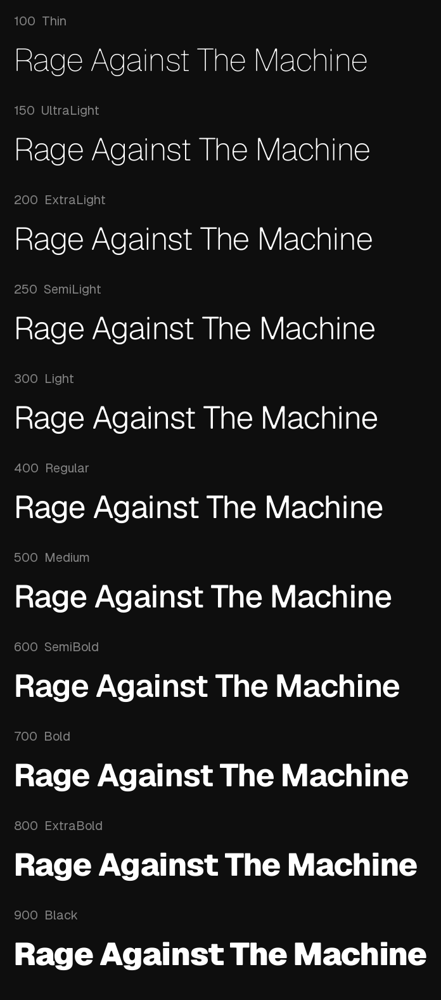
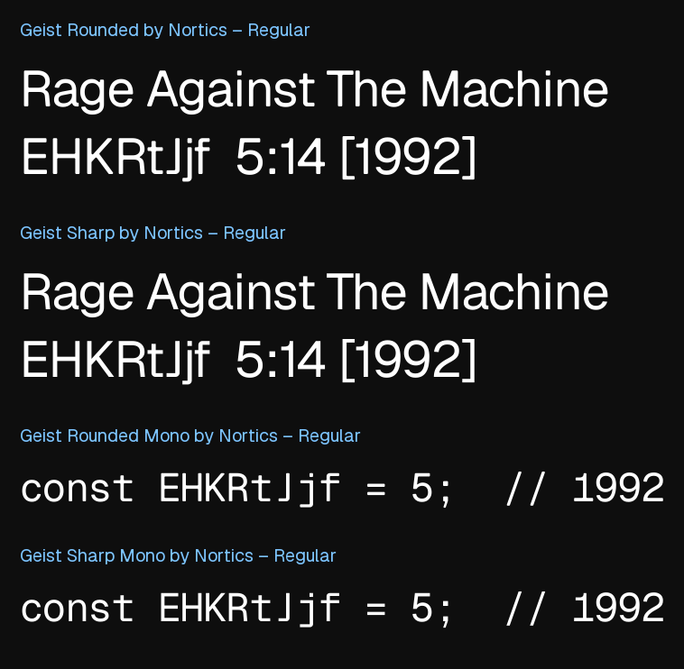
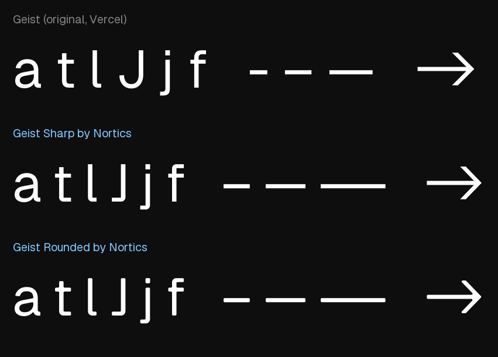
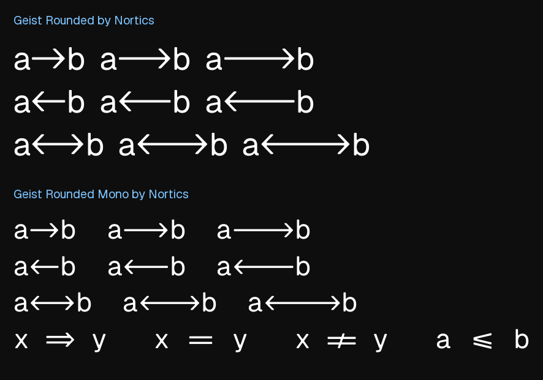

# Nortics Geist

**A rounded and a sharp adaptation of [Geist](https://github.com/vercel/geist-font) and Geist Mono, by Andre Dorneles.**
Four families, 40 static fonts, free to use under the [SIL Open Font License 1.1](OFL.txt).



## The four families

| Family | Corners | Fonts | Weights |
| --- | --- | --- | --- |
| **Geist Rounded by Nortics** | rounded (radius 20/1000 em) | 11 | 100 Thin · 150 UltraLight · 200 ExtraLight · **250 SemiLight** · 300 Light · 400 Regular · 500 Medium · 600 SemiBold · 700 Bold · 800 ExtraBold · 900 Black |
| **Geist Rounded Mono by Nortics** | rounded | 9 | 100 Thin · 200 ExtraLight · **250 SemiLight** · 300 Light · 400 Regular · 500 Medium · 600 SemiBold · 700 Bold · 800 ExtraBold |
| **Geist Sharp by Nortics** | square | 11 | same as Rounded sans |
| **Geist Sharp Mono by Nortics** | square | 9 | same as Rounded mono |

Rounded and Sharp are the same design; Sharp simply keeps the square corners of the original. Each family is installable on its own and none of them conflicts with the original Geist (the names are different).



## What is different from Geist

- **Rounded corners** in the Rounded families: every straight corner becomes a circular fillet of 20 font units.
- **New terminals** on `t l J j f`: a flat foot with a tight outer curve instead of the wide hook (in the Mono, the typewriter `l`, `i` and `j` flags are kept).
- **Longer dashes:** hyphen, en dash and em dash are 50% longer (in the Mono they are limited by the fixed cell).
- **Tighter spacing:** 0.020 em less per character (Mono cell 600 → 580 units).
- **New intermediate weight 250 (SemiLight)** between ExtraLight and Light (plus 150 UltraLight in the sans).
- **Arrow ligatures:** `->` `-->` `--->` `<-` `<--` `<---` `<->` `<-->` `<--->`, in both sans and mono, with monospaced columns preserved in the Mono.





Full details, with every parameter: [docs/DESIGN-CHANGES.md](docs/DESIGN-CHANGES.md).

## Download

- **Everything:** [download the repository as a ZIP](https://github.com/younner-org/nortics-geist-typeface/archive/refs/heads/main.zip) and use the `fonts/` folder, or
- a tagged release: `https://github.com/younner-org/nortics-geist-typeface/archive/refs/tags/v1.100.zip`, or
- individual files straight from [`fonts/`](fonts/) (`ttf/` for desktop, `woff2/` for web).

```
git clone https://github.com/younner-org/nortics-geist-typeface.git
```

## Install

- **Desktop (Windows / macOS / Linux):** install the `.ttf` files of the families you want. See [docs/USAGE.md](docs/USAGE.md).
- **Web:** self-host the `.woff2` files and link [`web/webfonts.css`](web/webfonts.css):

```html
<link rel="stylesheet" href="web/webfonts.css">
<style>
  body { font-family: "Geist Rounded by Nortics", system-ui, sans-serif; font-weight: 400; }
  code { font-family: "Geist Rounded Mono by Nortics", ui-monospace, monospace; }
  .light { font-weight: 250; } /* SemiLight */
</style>
```

Or load it from the jsDelivr CDN, pinned to a release (no hosting needed):

```html
<link rel="stylesheet" href="https://cdn.jsdelivr.net/gh/younner-org/nortics-geist-typeface@v1.100/web/webfonts.css">
```

Open [`web/specimen.html`](web/specimen.html) to preview every weight.

## Language support

English, Portuguese (pt-BR / pt-PT) and Spanish are fully covered in all 40 fonts, and French, Italian and German were checked as well. The project is Latin-first: the design work was reviewed for Latin glyphs, while the other scripts inherited from Geist (for example Cyrillic and Greek) went through the same automatic processing without manual review. See [docs/GLYPH-COVERAGE.md](docs/GLYPH-COVERAGE.md).

## Repository layout

```
fonts/<family>/ttf     desktop fonts          fonts/<family>/woff2   web fonts
web/                   webfonts.css + specimen.html
docs/                  full documentation     docs/images/           specimens
source/                build and QA scripts   OFL.txt, licenses/       licenses (OFL for fonts, MIT for the rest)
```

## Documentation

| Document | Contents |
| --- | --- |
| [docs/SPECIFICATION.md](docs/SPECIFICATION.md) | families, weights, name table, metrics, metadata, file format (generated from the fonts) |
| [docs/DESIGN-CHANGES.md](docs/DESIGN-CHANGES.md) | every modification relative to Geist, with parameters and algorithms |
| [docs/OPENTYPE-FEATURES.md](docs/OPENTYPE-FEATURES.md) | feature matrix and the complete ligature tables (generated) |
| [docs/GLYPH-COVERAGE.md](docs/GLYPH-COVERAGE.md) | Unicode blocks and language checks (generated) |
| [docs/USAGE.md](docs/USAGE.md) | installation, CSS, code editors, ligature control |
| [docs/BUILD.md](docs/BUILD.md) | how to rebuild every file from the upstream fonts |
| [docs/QA.md](docs/QA.md) | verification performed and its results, known limitations |
| [docs/LICENSING.md](docs/LICENSING.md) | what the licenses allow, in plain language |
| [CREDITS.md](CREDITS.md) · [CHANGELOG.md](CHANGELOG.md) · [CONTRIBUTING.md](CONTRIBUTING.md) | credits, history, how to contribute |

## License

- **Fonts** (everything in `fonts/`): [SIL Open Font License 1.1](OFL.txt). You may use them freely, including commercially, embed them, modify them and redistribute them, as long as the copyright notice and the license travel with them and modified versions are also released under the OFL. They may not be sold on their own.
- **Scripts, web files and documentation:** [MIT](licenses/MIT.txt).
- Details, the exact file map and a plain-language explanation: [docs/LICENSING.md](docs/LICENSING.md).

## Credits and independence

Nortics Geist is derived from **Geist** and **Geist Mono**, Copyright (c) 2023 Vercel, in collaboration with basement.studio (SIL OFL 1.1), by permission of that license. Adaptation by **Andre Dorneles**, published by [younner-org](https://github.com/younner-org).

This is an independent project. It is **not affiliated with, endorsed by or sponsored by** Vercel or basement.studio; their names are used only to acknowledge the origin of the fonts.
